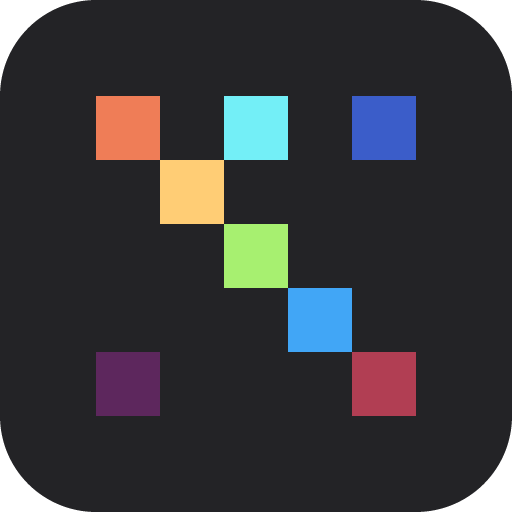
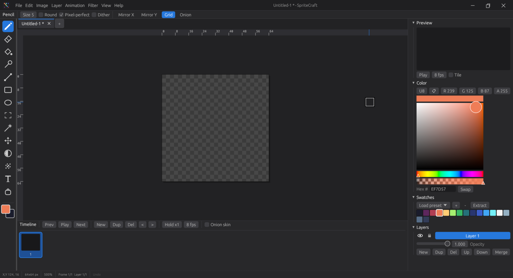

# SpriteCraft 0.2.0
2D pixel art & animation studio in Rust (egui). Adobe-style layout: title bar with menus, options bar, toolbox, project tabs, canvas with rulers, Preview/Color/Swatches/Layers panels, and a bottom Timeline.

## Install
    ./install.sh              # user install to ~/.local (installs deps + Rust automatically)
    ./install.sh --system     # /usr/local
    ./install.sh --uninstall

Re-running the script updates an existing install. Supports dnf, apt, pacman, zypper and apk.

## Build installable packages (written to ./dist)
    ./install.sh --package deb        # Debian/Ubuntu
    ./install.sh --package rpm        # Fedora/RHEL/openSUSE
    ./install.sh --package appimage   # portable, any distro
    ./install.sh --package flatpak    # built inside the Flatpak SDK (needs internet + flathub)
    ./install.sh --package exe        # Windows x64 (cross-compiled with mingw-w64 on Linux)
    ./install.sh --package msi        # Windows installer (built with wixl from msitools)
    ./install.sh --package dmg        # macOS - run on a Mac
    ./install.sh --package all        # everything this machine supports
    ./install.sh --list

Combine formats with commas (`--package deb,rpm,appimage`). Add `--no-deps` to skip system package installs.

Projects save as `.spc` (gzip JSON) in `~/SpriteCraft`. Help > Keyboard Shortcuts lists all shortcuts.
`tools/gen_icons.py` regenerates the PNG/ICO icons.
